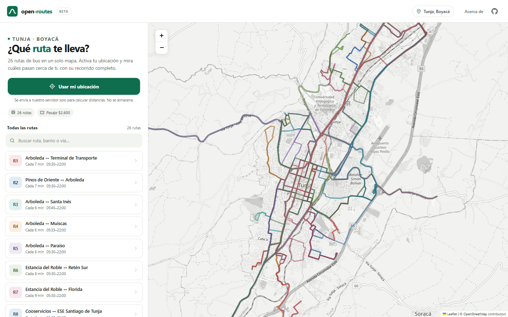
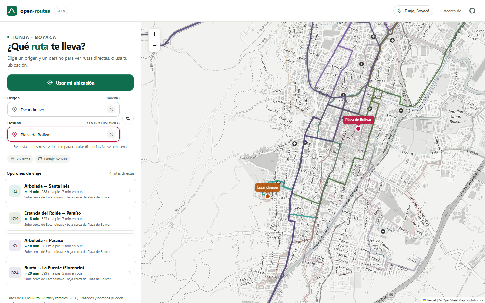
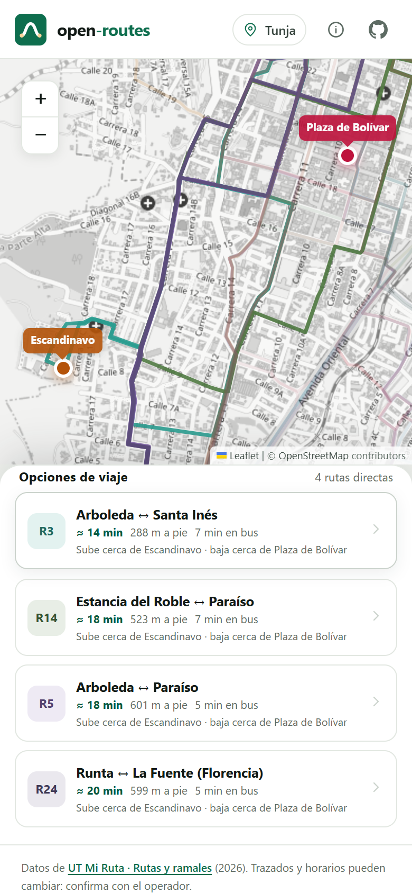

# open-routes

Rutas de transporte público claras y cerca de ti. Empieza en **Tunja, Boyacá** y está construido para sumar más ciudades sin tocar el código.

**En producción:** <https://open-routes.eridu.top>

| Escritorio | Móvil |
|---|---|
|  |  |

**Planear un viaje:**

| Escritorio | Móvil |
|---|---|
|  |  |

## Qué hace

- Elige un origen y un destino: muestra rutas directas ordenadas por tiempo estimado, con caminata, espera y tramo en bus.
- En ciudades con GTFS remoto, el mapa carga **30 rutas principales** y, al buscar un viaje, trae bajo demanda solo las rutas que pasan cerca del origen y del destino.
- Cambia de ciudad desde la cabecera o usa **Detectar mi ciudad**; la elección queda en `?city=` y en el navegador.
- Guarda **Casa** y **Trabajo** como favoritos y repite los últimos viajes con un toque.
- Comparte un viaje por enlace para que otra persona vea el mismo origen y destino.
- Guarda viajes completos para repetirlos y conservarlos sin conexión.
- Instala la app como PWA y consulta la última ciudad guardada sin conexión.
- Intercambia origen y destino, o usa tu ubicación como origen.
- Busca cualquiera de los 154 barrios y veredas oficiales de Tunja, un sitio o una dirección de OpenStreetMap.
- Toca un punto del mapa y ve todas las rutas del índice a menos de 300 m, no solo las 30 principales.
- Consulta paradas oficiales ordenadas y una próxima salida aproximada según la frecuencia.
- Para un barrio, solo se ofrecen rutas que entran en él o lo nombran; no las que pasan a varias cuadras.
- Ve avisos de cierres, desvíos y obras de las últimas 48 horas en una pestaña superior, sin ocupar la ventana principal.
- Consulta novedades de movilidad y las cuentas oficiales de Tunja sin cargar cookies de X.
- Activa tu ubicación y ordena las rutas por distancia real a su trazado (1 km a la redonda).
- Dibuja las rutas de la ciudad sobre un mapa claro, cada una con su color.
- Consulta trazados (ida y vuelta), vías por las que pasa, paradas, horarios y tarifas.
- Busca por código, nombre, barrio o vía.
- Responsive: sidebar en escritorio, panel inferior fijo en móvil.
- Sin cuentas, sin publicidad y sin guardar la ubicación.

## Stack

| Capa | Tecnología |
|---|---|
| Web | React 19 + Vite + TypeScript + SCSS + Leaflet (PWA instalable) |
| API | Java 21 + Spring Boot 3.5 |
| Datos | JSON local por ciudad + catálogo GTFS remoto con caché de 72 h (sin base de datos) |
| Mapa base | OpenStreetMap (sin API key ni Google Maps) |
| Despliegue | Docker multi-stage → JRE 21, publicado detrás de Cloudflare |

Una sola imagen sirve la API y el frontend compilado.

## Desarrollo

Requisitos: Java 21, Maven 3.9, Node 22+.

```bash
# API en http://localhost:8080
mvn -f api/pom.xml spring-boot:run

# Web en http://localhost:5173 (proxy /api → 8080)
cd web && npm install && npm run dev
```

Pruebas y build:

```bash
mvn -f api/pom.xml test
cd web && npm run build
node tools/planner-check.mjs   # requiere Node 24 (TypeScript nativo)
python tools/gtfs-check.py     # importador GTFS + fixture (Python 3.11+)
```

## API

| Endpoint | Qué devuelve |
|---|---|
| `GET /api/health` | Estado del servicio |
| `GET /api/cities` | Ciudades publicadas y metadatos |
| `GET /api/cities/{slug}` | Ciudad completa: rutas, geometrías y lugares buscables |
| `GET /api/cities/{slug}/routes/near?lat=&lng=&radius=800` | Rutas a menos de `radius` metros de un punto, ordenadas por distancia |
| `GET /api/cities/{slug}/search?q=calle+21` | Direcciones, barrios y sitios en OpenStreetMap, acotados a la ciudad |
| `GET /api/cities/{slug}/news` | Titulares de movilidad de Google News RSS, con fuente y fecha |
| `GET /api/cities/{slug}/alerts` | Cierres, desvíos, manifestaciones y obras de las últimas 48 h, filtrados por ciudad |
| `GET /api/cities/{slug}/trip-routes?fromLat=&fromLng=&toLat=&toLng=` | Rutas cercanas al origen y al destino, para cargar solo lo necesario |
| `GET /api/cities/{slug}/routes/near-bundle?lat=&lng=&radius=300` | Todas las rutas del índice que pasan cerca de un punto |

`radius` se limita a 50–5000 m. Las coordenadas fuera de rango devuelven 400. `search` exige entre 3 y 120 caracteres y cachea 24 h; `news` cachea 30 min. `trip-routes` y `routes/near-bundle` cachean 72 h y devuelven como máximo 60 rutas.

## Agregar una ciudad

La abstracción es el paquete de datos, no la ciudad: el código no cambia. Hay tres caminos.

### 1. Importar un feed GTFS (recomendado)

```bash
python tools/gtfs-import.py --gtfs feed.zip \
  --slug mi-ciudad --name "Mi Ciudad" --department "Boyacá" \
  --timezone America/Bogota --fare-day 2600 --fare-night 2700 \
  --source-label "Operador" --source-url "https://ejemplo.com/gtfs" \
  --output api/src/main/resources/cities/mi-ciudad.json
```

El feed puede ser un `.zip` o una carpeta con `routes.txt`, `trips.txt`, `shapes.txt`, `stops.txt` y `stop_times.txt`. El importador:

- convierte cada ruta en hasta dos sentidos (los grupos de viajes más frecuentes);
- usa el `shapes.txt` como trazado y cae a la secuencia de paradas si falta;
- deriva el horario del primer/último viaje y la frecuencia media;
- crea los lugares buscables a partir de las paradas, sin duplicarlas entre ida y vuelta;
- valida el resultado antes de escribirlo.

Después, reinicia la API. La ciudad aparece en `GET /api/cities` y el selector de la web se activa solo.

### 2. Escribir el JSON a mano

1. Crea `api/src/main/resources/cities/<slug>.json` con el esquema de `tunja.json` (ciudad, zona horaria, tarifa, fuentes, lugares y rutas).
2. Cada ruta necesita `id`, `code`, `name`, `color`, `weekday`, `sunday`, `circular`, `directions` y, por sentido, `paths` (listas de `[lat, lng]`) y `stops`. `streets` puede ir vacío: la ficha oculta esa sección.
3. Agrega en `places` los barrios y sitios buscables: `id`, `name`, `type`, `lat`, `lng` y `aliases`. Es lo que alimenta el buscador local y define el rectángulo donde Nominatim busca direcciones.
4. Opcional: agrega `social` con `label`, `handle` y `url` para mostrar cuentas oficiales en la sección de movilidad.
5. Reinicia la API. `CityValidator` rechaza el arranque si falta un campo, hay IDs repetidos, un color inválido, una zona horaria que no existe o un trazado con menos de dos puntos; el mensaje dice qué ciudad y qué ruta corregir.

`python tools/gtfs-check.py` importa el fixture `tools/fixtures/gtfs-mini` como carpeta y como zip, comprueba el contrato y compara el resultado con la muestra que valida el backend. Si cambias el importador a propósito, regenera la muestra con `--update`.

`node tools/tunja-places.mjs` actualiza los 154 barrios y veredas oficiales de Tunja desde Datos Abiertos y los mezcla con los lugares curados. `tools/tunja-routes.mjs` lee esa misma lista para no perderla al regenerar las rutas.

### 3. Catálogo remoto (Bogotá y futuras ciudades)

Para no empaquetar una ciudad grande, agrega una entrada en `api/src/main/resources/remote/cities.json`:

```json
{
  "slug": "bogota",
  "name": "Bogotá",
  "center": { "lat": 4.65, "lng": -74.1 },
  "zoom": 11,
  "timezone": "America/Bogota",
  "sources": [{ "label": "GTFS oficial", "url": "https://..." }],
  "fare": { "day": 0, "night": 0, "currency": "COP", "note": "No incluida en el feed." },
  "feed": {
    "discoveryUrl": "https://.../search?q=gtfs",
    "fallbackUrl": "https://.../feed.zip",
    "mapRoutes": 30,
    "simplifyTolerance": 0.0001
  }
}
```

El backend descarga el feed, construye todas las rutas para el índice y publica solo `mapRoutes` en el mapa. Al buscar un viaje, `trip-routes` devuelve las rutas cercanas al origen y al destino. Todo se guarda **72 h** en `/app/cache/<slug>.json.gz` y se sirve con gzip. Si el feed falla, se usa la copia anterior.

La primera construcción de Bogotá tarda decenas de segundos (119 MB, 1.053 rutas, 9,4 M filas de horarios); las siguientes cargas salen de caché. El contenedor la precalienta al arrancar (`OPENROUTES_REMOTE_WARMUP=true`).

### Límites del importador

- Toma hasta dos sentidos por ruta; ramales adicionales del mismo `route_id` se descartan.
- El horario es aproximado (primer viaje, último viaje y frecuencia media); no modela franjas, festivos ni servicios por calendario.
- No infiere circuitos: deja `circular: false`, incluso si el trazado cierra.
- No inventa vías: deja `streets` vacío y la ficha muestra solo el trazado y las paradas.
- La tarifa se pasa a mano porque GTFS no la incluye.

## Datos y límites

- Tunja: fuente de trazados y horarios, [UT Mi Ruta · Rutas y ramales](https://www.utmiruta.com/rutasyramalaesutmiruta) (2026).
- Barrios y veredas de Tunja: [Datos Abiertos Colombia · Alcaldía de Tunja](https://www.datos.gov.co/Vivienda-Ciudad-y-Territorio/Informaci-n-Barrios-y-veredas-de-Municipio-de-Tunja/4ryc-k7fx), licencia CC BY-SA 4.0. El código sigue bajo MIT.
- Los datos del operador se usan como referencia; el proyecto no reclama una licencia abierta sobre ellos. La licencia MIT cubre el código.
- Tarifa: $2.600 de lunes a sábado entre 06:00 y 19:00; $2.700 en horario nocturno (19:01–05:59), domingos y festivos (Decreto 0006 de 2026). No aplica a la ruta intermunicipal R19.
- Los recorridos, horarios y tarifas pueden cambiar. La información del operador manda; esta app es una ayuda para leer el sistema, no un aviso oficial.
- Los trazados son los del mapa público del operador. Algunos ramales se dibujan como segmentos separados porque así están en el KML original.
- Los lugares buscables incluyen los 179 barrios, veredas y sitios de Tunja. Los barrios y veredas vienen del dataset oficial de la Alcaldía (CC BY-SA 4.0); las direcciones y puntos de interés se buscan en OpenStreetMap solo cuando el usuario lo pide.
- Bogotá: [TransMilenio · GTFS estático](https://datosabiertos.bogota.gov.co/dataset/especificacion-gtfs-general-transport-feed-specification-sitp), CC BY-SA 4.0. El feed se descubre y se cachea 72 h; el mapa muestra 30 rutas principales y el planificador carga el resto por viaje. La ficha indica cuándo se actualizaron los datos.
- Los favoritos, viajes recientes y enlaces compartidos se guardan en el navegador. Los viajes guardados precargan su bundle de rutas para funcionar sin conexión; las búsquedas nuevas y las noticias necesitan red.
- En ciudades GTFS las paradas se muestran en el orden del viaje representativo. La “próxima salida” es una estimación por frecuencia, no un tiempo real ni una parada oficial de paso.
- Cada ciudad puede ser un JSON local o una entrada del catálogo remoto, validada al arrancar. El selector aparece cuando hay más de una y `Detectar mi ciudad` usa la ubicación del navegador si el usuario lo permite.
- El planificador combina los trazados para encontrar **rutas directas** (sin transbordos). Los tiempos son estimaciones sobre la geometría: incluyen caminata, espera y bus, pero no tráfico, semáforos ni paradas oficiales.
- R10 y R22 están marcadas como circulares por el operador; el planificador cierra la vuelta solo si el trazado termina cerca del inicio. R8, R13 y R18 tienen fragmentos en el mapa: se avisa que no se pueden verificar como directas en vez de inventar la conexión.
- La espera usa la frecuencia del día actual en la zona horaria de la ciudad; no comprueba festivos ni disponibilidad en tiempo real. Las consultas fuera del horario publicado se marcan; una frecuencia desconocida se muestra como “sin espera”.
- La geolocalización se calcula contra la línea del recorrido, no contra paradas oficiales (el operador no publica esas paradas).
- La cercanía del mapa se calcula en el navegador. En ciudades remotas, al buscar un viaje se envían coordenadas redondeadas a la API para traer solo las rutas que sirven; el resultado se cachea 72 h en IndexedDB. La API sigue exponiendo `/near` para integraciones.
- Los feeds remotos y sus índices se guardan comprimidos con gzip en el volumen `open-routes-cache`; las respuestas JSON también viajan comprimidas.
- Las búsquedas de direcciones envían solo el texto consultado a OpenStreetMap a través de la API, con caché y un máximo de una petición por segundo; no se envían coordenadas de ubicación.
- Los titulares de movilidad vienen de Google News RSS y conservan el enlace y el crédito de su medio. Los avisos de cierre/desvío son titulares de prensa de las últimas 48 horas filtrados por ciudad, no avisos oficiales; confirma con el operador. No incrustamos X: las cuentas oficiales se abren en X para no cargar cookies de terceros.
- El mapa base consulta teselas de OpenStreetMap (recibe la zona visible y tu IP) y Cloudflare sirve el sitio con analítica sin cookies.

## Seguridad

- La API solo se publica en loopback; Cloudflare Tunnel es la única entrada externa.
- CSP estricta: se permite `style-src 'unsafe-inline'` porque Leaflet aplica estilos inline, y `static.cloudflareinsights.com` para la analítica sin cookies de Cloudflare. El resto es same-origin.
- La web calcula la cercanía en el navegador y no envía coordenadas a la API. Las direcciones se consultan en OpenStreetMap a través de la API; el mapa base consulta teselas de OpenStreetMap (recibe IP y zona visible).

## Despliegue

```bash
docker compose up -d --build
curl -s http://127.0.0.1:5179/api/health
```

En el servidor se publica solo en loopback (`127.0.0.1:5179`) y Cloudflare Tunnel lo expone en `open-routes.eridu.top`.

El volumen `open-routes-cache` conserva los feeds construidos entre reinicios. El contenedor tiene 900 MB de límite porque la primera construcción de Bogotá descarga y procesa 119 MB; después solo lee el `.json.gz`.

Runbook: `~/sitios/open-routes` en el servidor, rama `develop`, puerto local `5179`; el túnel y el DNS están documentados en `server/README.md`.

## Licencia

MIT © 2026 jdsalasca.
