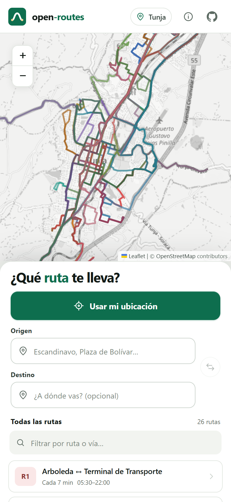
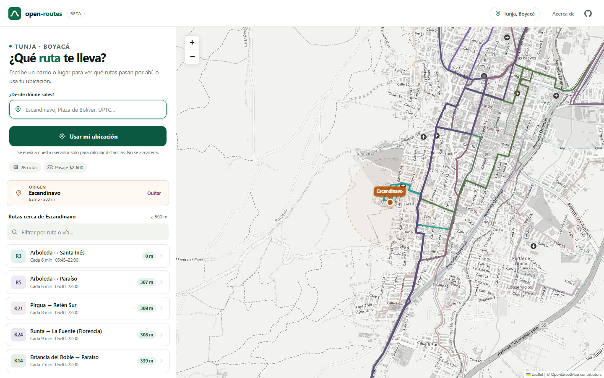
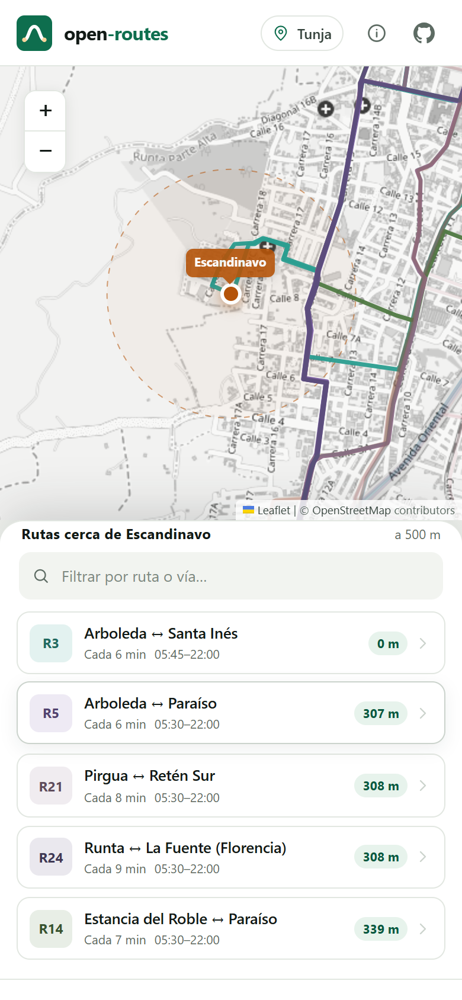

# open-routes

Rutas de transporte público claras y cerca de ti. Empieza en **Tunja, Boyacá** y está construido para sumar más ciudades sin tocar el código.

**En producción:** <https://open-routes.eridu.top>

| Escritorio | Móvil |
|---|---|
|  |  |

**Buscar un origen:**

| Escritorio | Móvil |
|---|---|
|  |  |

## Qué hace

- Activa tu ubicación y ordena las rutas por distancia real a su trazado (1 km a la redonda).
- Busca un barrio o lugar (Escandinavo, Plaza de Bolívar, UPTC…) y úsalo como origen: muestra las rutas a menos de 500 m, con su distancia.
- Dibuja las 26 rutas de la UT Mi Ruta sobre un mapa claro, cada una con su color.
- Consulta trazados (ida y vuelta), vías por las que pasa, paradas de despacho, horarios y tarifas de 2026.
- Busca por código, nombre, barrio o vía.
- Responsive: sidebar en escritorio, panel inferior fijo en móvil.
- Sin cuentas, sin publicidad y sin guardar la ubicación.

## Stack

| Capa | Tecnología |
|---|---|
| Web | React 19 + Vite + TypeScript + SCSS + Leaflet |
| API | Java 21 + Spring Boot 3.5 |
| Datos | JSON por ciudad en el classpath (sin base de datos) |
| Mapa base | OpenStreetMap (sin API key ni Google Maps) |
| Despliegue | Docker multi-stage → JRE 21, publicado detrás de Cloudflare |

Una sola imagen sirve la API y el frontend compilado.

## Desarrollo

Requisitos: Java 21, Maven 3.9, Node 22+.

```bash
# API en http://localhost:8080
mvn -f api/pom.xml spring-boot:run

# Web en http://localhost:5173 (proxy /api → 8080)
cd web && npm install && npm run dev
```

Pruebas y build:

```bash
mvn -f api/pom.xml test
cd web && npm run build
```

## API

| Endpoint | Qué devuelve |
|---|---|
| `GET /api/health` | Estado del servicio |
| `GET /api/cities` | Ciudades publicadas y metadatos |
| `GET /api/cities/{slug}` | Ciudad completa: rutas, geometrías y lugares buscables |
| `GET /api/cities/{slug}/routes/near?lat=&lng=&radius=800` | Rutas a menos de `radius` metros de un punto, ordenadas por distancia |

`radius` se limita a 50–5000 m. Las coordenadas fuera de rango devuelven 400.

## Agregar una ciudad

La abstracción es el archivo de datos, no la ciudad:

1. Crea `api/src/main/resources/cities/<slug>.json` con el esquema de `tunja.json` (ciudad, tarifa, fuentes, lugares y rutas).
2. Cada ruta necesita `id`, `code`, `name`, `color`, `directions` y, por sentido, `paths` (listas de `[lat, lng]`) y `streets`.
3. Agrega en `places` los barrios y sitios buscables: `id`, `name`, `type`, `lat`, `lng` y `aliases`. Es lo que alimenta el buscador de origen.
4. Reinicia la API. La ciudad aparece en `GET /api/cities` y el selector de la web se activa solo.

El importador `tools/tunja-routes.mjs` documenta cómo se convirtieron los mapas KML de la UT Mi Ruta en el JSON de Tunja. Sirve de referencia para escribir otros importadores; no se ejecuta en producción.

## Datos y límites

- Fuente de trazados y horarios: [UT Mi Ruta · Rutas y ramales](https://www.utmiruta.com/rutasyramalaesutmiruta) (2026).
- Los datos del operador se usan como referencia; el proyecto no reclama una licencia abierta sobre ellos. La licencia MIT cubre el código.
- Tarifa: $2.600 de lunes a sábado entre 06:00 y 19:00; $2.700 en horario nocturno (19:01–05:59), domingos y festivos (Decreto 0006 de 2026). No aplica a la ruta intermunicipal R19.
- Los recorridos, horarios y tarifas pueden cambiar. La información del operador manda; esta app es una ayuda para leer el sistema, no un aviso oficial.
- Los trazados son los del mapa público del operador. Algunos ramales se dibujan como segmentos separados porque así están en el KML original.
- Los lugares buscables son 42 barrios y sitios principales. Cuando no hay un nodo oficial, el punto es el despacho/retorno del operador; por eso el radio de búsqueda es de 500 m.
- La geolocalización se calcula contra la línea del recorrido, no contra paradas oficiales (el operador no publica esas paradas).
- Las coordenadas se envían al endpoint de cercanía para calcular distancias. No se guardan en la app ni en base de datos; la respuesta se marca `Cache-Control: no-store`.

## Despliegue

```bash
docker compose up -d --build
curl -s http://127.0.0.1:5179/api/health
```

En el servidor se publica solo en loopback (`127.0.0.1:5179`) y Cloudflare Tunnel lo expone en `open-routes.eridu.top`.

Runbook: `~/sitios/open-routes` en el servidor, rama `develop`, puerto local `5179`; el túnel y el DNS están documentados en `server/README.md`.

## Licencia

MIT © 2026 jdsalasca.
